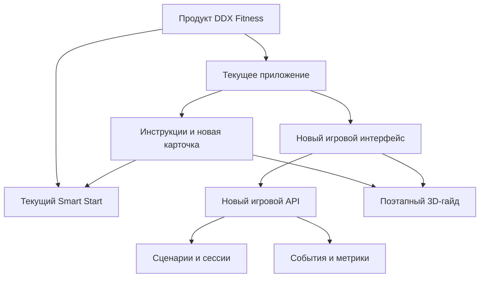

# 00. Декомпозиция фичи в существующем продукте

## От продукта к изменению

Фича не является новым приложением. Для игрока это дополнительный сценарий внутри DDX: вход, три станции с паузой, результат и возврат к реальной услуге. Для разработки это изменения в клиенте и отдельный предложенный доменный контур с интеграцией в уже действующие механизмы.

## Ответственность и точка изменения

| Компонент | Изменение | Владелец данных / решение |
| --- | --- | --- |
| Авторизация, членство, клуб | проверить идентификатор участника и право на запуск; переиспользовать штатное восстановление входа | существующий продукт DDX; игровой API получает только результат проверки |
| Навигация и флаг приложения | карточка входа, «Продолжить», маршрут из результата в Smart Start, выключение/пилот | команда мобильного продукта |
| Существующий каталог инструкций | карточка модели, фильтр производителя и новый тип материала рядом с видео | каталог DDX; реальные ID и права на контент уточняются |
| Контент 3D-гайда | версионированный GLB, клипы, активные зоны, текст, видео-резерв и связь с модификацией скамьи | отдельный контентный контур; FW-702 до сверки с клубом |
| Игровой интерфейс | 3 станции, шесть шагов помощи на скамье, ошибка, результат, доступное управление без обязательного перетаскивания | новая фича в мобильном клиенте |
| Мобильная оболочка | локальный черновик, нестабильная сеть, проверка версии, маршрут Smart Start, отклик iPhone | приложение DDX; сервер остаётся владельцем подтверждённого состояния |
| Игровой API | запуск, чтение, действия, проверка ответов и состояния, устранение повторов | новый домен игры |
| Хранилище игры | сценарий, сессия, попытки, ключи идемпотентности, исходящие события | новый домен игры |
| Аналитика | серверные переходы и клиентские показы/клики; эксперимент | платформа аналитики + домен игры |
| Smart Start | список занятий и бронирование | существующий модуль; не меняет владельца из-за игры |

## Состав работ для первой версии

| Блок / история | Результат | Зависимость | Требования / приёмка |
| --- | --- | --- | --- |
| E0. Интеграционный контракт | согласованы субъект токена, флаг, маршрут Smart Start, источник события записи | владельцы DDX | ADR-01, ADR-05, вопросы 1–4 |
| E0a. Каталог и права на 3D | подтверждённая модель в клубе, ID каталога, лицензированный ассет и ревью тренера | владелец каталога и оборудования | REQ-18,19 / AC-28–30 |
| E1. Вход и сессия | карточка, доступность, START, RESUME, история | E0; игровой API | REQ-01,02,05 / AC-01,02,08,11 |
| E2. Игровые станции | гантели, штанга 77,5 кг, 8 предметов; серверная проверка | E1; снимок сценария | REQ-03 / AC-03,04,07 |
| E3. Событие помощи | пауза после штанги, шесть шагов, возобновление | E2; модель состояний | REQ-04,18,19 / AC-05,06,27–30 |
| E4. Надёжность сессии | версия, идемпотентность, сеть, отказ, истечение, повторный проход | E1–E3; хранилище | REQ-06,08,09,11,12 / AC-09,10,13–15,17,18 |
| E5. Smart Start и измерение | кнопка результата, события, атрибуция при доступном сигнале записи | E0, E1–E4; текущий Smart Start | REQ-07,10 / AC-12,16 |
| E5a. Мобильная устойчивость | черновик, восстановление, схема клиента, тактильный отклик, маршрут | E1–E4; платформа iOS | REQ-13–16 / AC-19–24,26 |
| E5b. Асинхронные события | версионированный контракт и доставка через брокер, если он принят в DDX | E0, E4; интеграционная платформа | REQ-17 / AC-25 |
| E6. Пилот | договорённость о сегменте, контрольная группа, проверка метрик/ошибок | E0–E5b | план измерения в 05-events |

## Вертикальные срезы реализации

1. **Срез A: вход и одна сессия.** Флаг → карточка → создание → GET/продолжение. Можно проверить владение и одну активную сессию.
2. **Срез B: игровой цикл.** Три проверки и обязательный HELP. Можно пройти от DUMBBELLS до RESULT; неверные ответы остаются на этапе.
3. **Срез C: устойчивость.** Отказ, истечение, повтор, смена устройства, потеря ответа и конкурирующие команды.
4. **Срез D: продуктовая интеграция.** Навигация в Smart Start и наблюдаемая воронка; пилот включается после сквозной приёмки.

## Граница релиза

Пользователь видит фичу только когда приложение умеет отрисовать текущую версию сценария, игровой API доступен и флаг разрешён. Отдельный выпуск игровой API возможен заранее под выключенным флагом. Контракт `scenarioVersion` фиксирует несовместимые изменения; для старых клиентов нужен список поддерживаемых версий и стратегия обновления.

Уточнить до разработки: где размещён вход, как проверяется членство, как выглядит фактический маршрут Smart Start, какие события уже существуют. Эти неизвестные нельзя заполнять вымышленными названиями внутренних DDX-сервисов.
