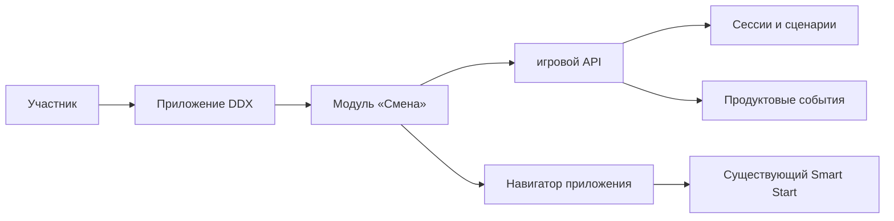
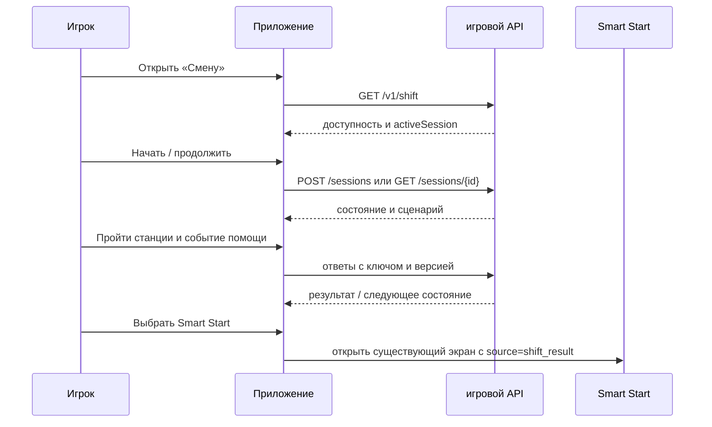

# 01. Контекст и границы системы

## Текущее состояние: известное и неизвестное

DDX предлагает Smart Start как формат знакомства с залом, а запись доступна через мобильное приложение. Открытые материалы не раскрывают навигационный стек приложения, внутренние сервисы авторизации, расписания, бронирования и аналитики. Поэтому здесь нет утверждений о реально существующих URL, таблицах или очередях DDX.

## Целевой сценарий: где живёт «Смена»

1. Авторизованный участник открывает карточку «Смена» в приложении (предлагаемая точка входа: карточка практики рядом с действующими инструкциями к тренажёрам в профиле; точное размещение решает продуктовая команда).
2. Приложение проверяет доступность фичи и наличие незавершённой сессии через игровой API. При наличии сессии предлагает «Продолжить».
3. Игровой модуль отображает серверный снимок сценария и посылает ответы станций в игровой API. Сервер определяет правильность, переходы и версию сессии.
4. После третьей станции модуль показывает результат и кнопку «Выбрать Smart Start». Внутренний навигатор приложения открывает существующий каталог/расписание Smart Start.
5. Система записи самостоятельно проверяет доступность занятия, членство и выполняет бронирование. Игра в этот контур не пишет.

### Контракты на границе

| Владелец | Нужно от существующего продукта | В случае недоступности |
| --- | --- | --- |
| Авторизация приложения | устойчивый идентификатор пользователя в токене доступа; проверка токена игровым API | показывается штатное восстановление входа, игровое действие не отправляется анонимно |
| Навигация | поддерживаемая команда открытия Smart Start с параметром источника | кнопка скрывается/показывает ошибку навигации, результат сохраняется |
| Smart Start | существующий экран списка/слотов и правила записи | игра не подтверждает запись за него |
| Аналитика | единый формат идентификатора пользователя и событий, если он есть | локальная аналитика игры считает переходы; бронирование не приписывается игре без связующего события |
| Конфигурация приложения | флаг запуска и доступные сегменты/клубы | при выключенном флаге вход закрыт, начатые сессии доступны только по согласованной политике |

## Роли и допущения MVP

- Игрок — авторизованный пользователь приложения с активным доступом к клубу. Гостевой режим и несовершеннолетние сценарии не входят в MVP; юридические ограничения проверяются владельцем продукта.
- Игра **симулирует** роль дежурного тренера. Событие помощи — персонаж внутри игры, не реальный вызов персонала и не канал обслуживания.
- Одна незавершённая сессия на пользователя. Её можно продолжить на другом устройстве под тем же аккаунтом.
- Сессия истекает после 7 суток без активности; это параметр конфигурации, а не утверждение о правилах DDX.
- Таймера прохождения нет. Фоновый режим приложения не меняет статус сессии.
- Пилот запускается одним сценарием и в выбранном сегменте через флаг; условия сегмента и расположение карточки надо согласовать с DDX.

## Минимальный путь пользователя

## Данные и безопасность

Игровой API хранит технический идентификатор участника, снимок задания, ответы и время. Имя, контакты, медицинские данные, реальные обращения посетителей и данные бронирования в нём не нужны. Доступ к сессии проверяется по владельцу из токена; ID из URL недостаточно. Сроки хранения и правовое основание определяются политиками DDX до внедрения.
