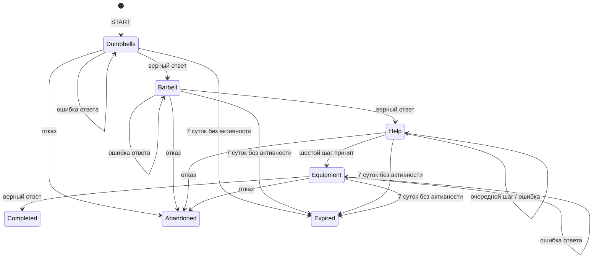

# 03. Жизненный цикл сессии

## Состояние

Сервер хранит пару `status` + `stage`, монотонную `version` и, при PAUSED_HELP, `helpProgress.nextStepIndex`. Разрешённые пары: `ACTIVE/DUMBBELLS`, `ACTIVE/BARBELL`, `PAUSED_HELP/HELP`, `ACTIVE/EQUIPMENT`, `COMPLETED/RESULT`, `ABANDONED/NONE`, `EXPIRED/NONE`. Иные комбинации запрещены.

На диаграмме `Dumbbells/Barbell/Equipment` = `ACTIVE` с соответствующим `stage`; `Help` = `PAUSED_HELP/HELP`. Закрытие приложения, потеря сети и переход к Smart Start статуса не меняют.

## Таблица переходов

| Текущее | Команда/условие | Проверка | Новое | Побочный результат |
| --- | --- | --- | --- | --- |
| нет незавершённой | START | доступен флаг и членство | ACTIVE/DUMBBELLS, v1 | session_started |
| ACTIVE/DUMBBELLS | SUBMIT_DUMBBELLS | ответ верный | ACTIVE/BARBELL, v+1 | attempt, stage_completed |
| ACTIVE/BARBELL | SUBMIT_BARBELL | ответ верный | PAUSED_HELP/HELP, v+1 | attempt, stage_completed, help_shown |
| PAUSED_HELP/HELP | HELP_ACT | `stepId` и `targetId` соответствуют ожидаемому шагу | PAUSED_HELP/HELP, индекс +1 и v+1; после шестого шага ACTIVE/EQUIPMENT | game_stage_attempted, game_help_step_completed; после шестого game_help_resolved |
| ACTIVE/EQUIPMENT | SUBMIT_EQUIPMENT | ответ верный | COMPLETED/RESULT, v+1 | attempt, stage_completed, session_completed |
| любая не терминальная | неверный ответ/выбор | валидная структура команды | та же пара, v+1 | запись попытки и `game_stage_attempted`; для HELP stage=HELP |
| любая не терминальная | ABANDON | владелец и версия | ABANDONED/NONE, v+1 | session_abandoned |
| любая не терминальная | EXPIRE | `now >= expiresAt` | EXPIRED/NONE, v+1 | session_expired |
| любая | RESUME (GET) | владелец | без изменения | текущий снимок |
| терминальная | START | нет иной не терминальной | новая ACTIVE/DUMBBELLS v1 | новая независимая сессия |

**Приоритет времени:** перед каждой командой изменения сервер в транзакции проверяет `expiresAt`; если срок наступил, фиксирует EXPIRED и отвечает `SESSION_EXPIRED`. Плановый обработчик может выполнить тот же переход раньше следующей команды. Терминальный переход выполняется только один раз.

**Неверный ответ:** семантически обработанная попытка сохраняется и повышает версию, даже если этап не изменился. HTTP 200 возвращает `accepted:false` и конкретную подсказку; это не транспортная ошибка.

**Повтор:** сервер сравнивает ключ идемпотентности до проверки текущей версии. Сохранённый ответ возвращается без нового перехода. Новый ключ со старой версией получает 409 VERSION_CONFLICT.

**Повторное прохождение:** прогресс никогда не «обнуляется» в той же сессии. Новый запуск создаёт новый ID и новый снимок опубликованного сценария; история завершённых попыток остаётся доступна в рамках политики хранения.

## Инварианты

1. У одного пользователя не больше одной сессии в ACTIVE или PAUSED_HELP.
2. Переход в RESULT возможен только после успешных DUMBBELLS, BARBELL, HELP и EQUIPMENT в заданном порядке.
3. Ответ нельзя отправить для этапа, который не является текущим.
4. Успешный переход, попытка и исходящее событие атомарны; `version` растёт ровно на единицу на новую обработанную команду.
5. После COMPLETED, ABANDONED или EXPIRED команды изменения старой сессии запрещены.
6. `scenarioSnapshot` и `scenarioVersion` сессии неизменны.
7. В HELP ожидается ровно `steps[nextStepIndex]`. Вращение камеры и повтор анимации не меняют серверное состояние. Последний шаг атомарно снимает паузу.

### Внутренние шаги HELP

`BACK_PIN → BACK_ADJUST → BACK_LOCK → SEAT_LEVER → SEAT_ADJUST → SEAT_LOCK`. Индексы 0…5. Ошибка активной зоны или порядка даёт `accepted:false`, сохраняет индекс и повышает версию как обработанная попытка. Повтор с тем же ключом возвращает прежний ответ. Это игровая проверка действий на модели, а не подтверждение настройки реальной скамьи.
