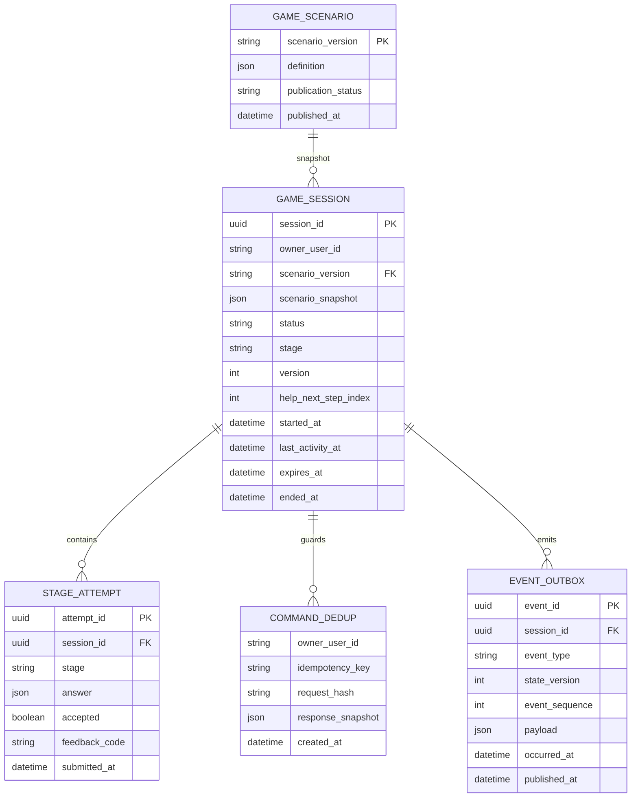

# 04. Модель данных

| Сущность | Правило |
| --- | --- |
| `game_scenario` | опубликованная версия неизменна; изменение механики требует новой версии |
| `game_session` | `owner_user_id` берётся из проверенного токена; partial unique index по владельцу для ACTIVE/PAUSED_HELP; `version >= 1`; `help_next_step_index` задаётся 0 при входе в HELP, растёт до 5, очищается после шестого шага; список завершённых шагов выводится из индекса и неизменного сценария |
| `stage_attempt` | запись на каждую новую обработанную попытку S1/S2/S3/каждого шага HELP; неверный ответ остаётся в истории; повтор того же ключа не создаёт запись |
| `command_dedup` | уникальный ключ (`owner_user_id`, `idempotency_key`); хранит хеш метода+пути+тела и итоговый код/тело ответа; срок не меньше срока сессии и окна сетевых повторов |
| `event_outbox` | уникальный ID, версия состояния и порядковый номер события внутри сессии создаются в одной транзакции с переходом; номер уникален в паре с `session_id` |

Для истории клиенту отдаётся краткий список ID, статуса, времени и версии сценария; все ответы и детальная аналитика доступны только внутренним системам по правилам доступа. Внешние сущности `User`, `Club`, `Booking` здесь представлены ссылочными идентификаторами/навигацией и не копируются в эту БД.

### Ограничения и транзакция команды

1. Проверить авторизацию и владение сессией.
2. Найти `command_dedup`; при совпадающем хеше вернуть сохранённый ответ, при отличающемся — 409 IDEMPOTENCY_KEY_REUSED.
3. Заблокировать строку сессии, проверить срок и `expectedVersion`, текущий этап и ответ.
4. Обновить сессию, сохранить попытку, ответ для повтора команды и исходящие события с последовательными `event_sequence` в одной транзакции.
5. Вернуть итоговое состояние. Отправка аналитики из таблицы исходящих событий происходит позже и не меняет игровой ответ.

Ключ дедупликации для START записывается отдельно от созданной сессии в той же транзакции; конкурентный START также защищён уникальностью активной сессии. При конфликте доступности безопасно вернуть ACTIVE_SESSION_EXISTS с ID уже существующей сессии.
