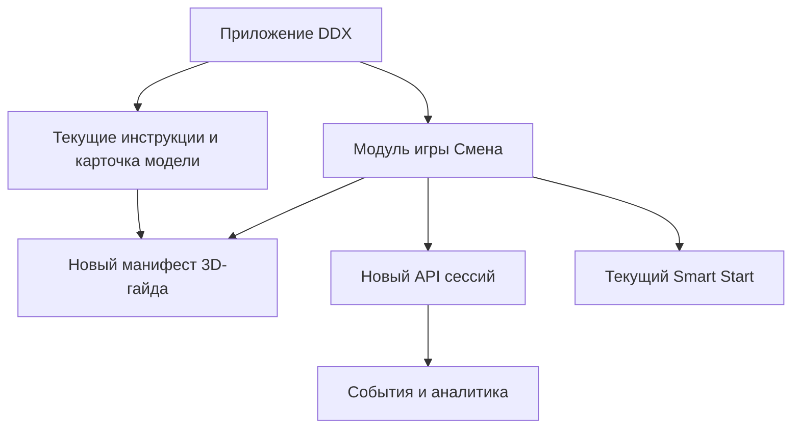

# 12. Мостик к DDX Fitness: источники, границы, внедрение

Проверено 6 октября 2026 года. Это архитектурное предложение для существующего приложения, а не описание его закрытой кодовой базы.

| Публично подтверждено | Источник | Вывод для кейса |
| --- | --- | --- |
| Приложение содержит видеоинструкции к тренажёрам; релиз 1.097.300 перенёс раздел в профиль, 1.100.300 добавил фильтры производителей, 1.099.300 улучшил поиск | [App Store, история версий](https://apps.apple.com/de/app/ddx-fitness/id1631792129) | Встраивать карточку «Интерактивная настройка» в существующую карточку модели раздела **Профиль → Инструкции к тренажёрам**, а не создавать отдельный каталог. Названия внутренних маршрутов неизвестны. |
| Запись на Smart Start уже есть в приложении | [описание приложения](https://apps.apple.com/ru/app/ddx-fitness/id1631792129) | Результат игры вызывает действующий навигатор записи; места и бронирование остаются у существующего модуля. |
| DDX Platform/CRM описывает Go/Gin, React/TypeScript, PostgreSQL, ClickHouse, Kubernetes, HTTP/REST | [DDX TECH](https://techddx.ru/) | Это стек **платформы CRM**. Он не доказывает, что клиентское мобильное приложение написано на React или что игра обязана жить в этой CRM. |
| В вакансии мобильного системного аналитика упоминаются iOS/Android, Flutter, REST и брокеры | [вакансия](https://dreamjob.ru/employers/123626/vakansii/136024930) | Это сигнал о требуемых компетенциях, не подтверждение фактической архитектуры мобильного клиента. Рендерер выбирают после проверки репозитория и поддержки устройств. |
| Для Foreman FW-702 производитель указывает Pull Pin для спинки и рычажный фиксатор сиденья | [карточка производителя](https://www.foremanfitness.ru/catalog/silovye-trenazhery/skami-i-stoyki/fw-702-universalnaya-skamya-0-90-grad/) | Можно специфицировать два разных органа управления. Точная геометрия, место рычага и наличие **именно FW-702 в клубах DDX** публично не подтверждены. Модель в кейсе — контрольный пример до сверки с каталогом и тренером. |

## Граница интеграции

1. Действующий каталог оборудования остаётся владельцем идентичности модели и её доступности по клубу. Проектный `equipmentCatalogRef=foreman/FW-702` — **суррогат для кейса**; реальный ID и варианты получаем у DDX. Поиск/фильтр производителя ведёт в существующую карточку. Там новый тип материала `INTERACTIVE_3D` соседствует с видео.
2. Для игры в профиле появляется карточка «Практика: смена в зале». Вход также допустимо показать в сценарии новичка по флагу. Игра сохраняет `guideId` и `guideVersion` в снимке задания, открывает тот же гайд в режиме HELP, затем возвращается к сохранённому шагу. Прямой просмотр гайда из профиля никогда не продвигает игру.
3. Новый игровой API проверяет доступность, хранит сессию и принимает команды. Проектный GET `/v1/equipment-guides/{guideId}` отдаёт метаданные и адрес версии ассета. Файлы 3D и видео доставляются CDN/хранилищем DDX по действующим правилам. Клиент проверяет хеш, кэширует по версии. Названия URL, CDN и токенов здесь условны.
4. Доступ к действующей авторизации и членству идёт через согласованный адаптер. Игра не заводит вторую учётную запись. Переход `SMART_START_CATALOG(source=shift_result)` — логическая команда навигатору, её фактическое имя нужно взять из мобильного проекта.
5. Рендер 3D размещается в экране мобильного приложения через совместимый с фактическим клиентом компонент/встраиваемый рендерер. Если клиент на Flutter, нужен проверенный мост к 3D и iOS Core Haptics; это вариант реализации, **не утверждение о стеке DDX**. Сначала технический прототип на целевых iPhone/Android, затем выбор движка.

## Разделение ответственности и выпуск

| Контур | Изменение | Проверка до релиза |
| --- | --- | --- |
| Контент оборудования | связка клуб → производитель/модель/вариант → `guideId`, права на 3D, подтверждение расположения фиксаторов | фото шильдика, руководство, ревью тренера и право использовать CAD/изображения |
| Мобильный клиент | вход из профиля, режим обычного гайда и режим HELP, 3D-поворот, клипы, текст, офлайн-кэш, видео-резерв, отклик iPhone | UX и память/нагрев/FPS на целевых устройствах; доступное управление |
| Игровой API | порядок шести действий, версия и идемпотентность, сессия, аналитика | AC-01…AC-30, отрицательные и сетевые проверки |
| Текущие сервисы | проверка доступа, каталог, навигация Smart Start, эксперимент | реальные внутренние контракты и события записи |

Флаг игры и флаг 3D-материала независимы: гайд можно проверять в карточке оборудования до включения игровой сессии. Если FW-702 отсутствует в каталоге конкретного клуба, игровую помощь надо заменить подтверждённой моделью и новой версией сценария; не выдавать чужую скамью за местную.
