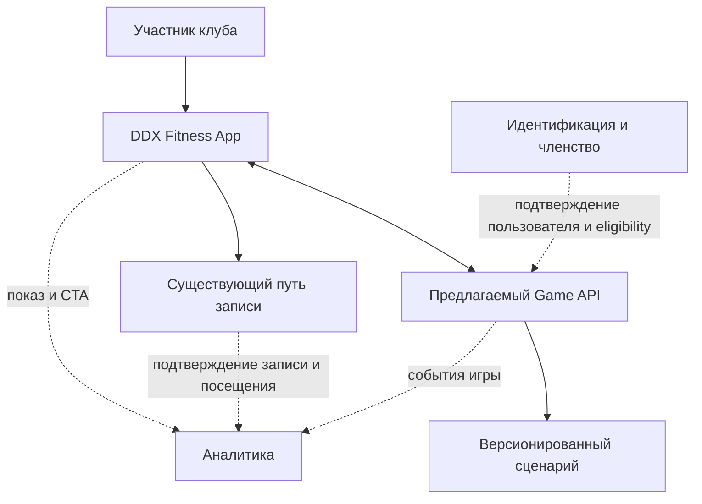
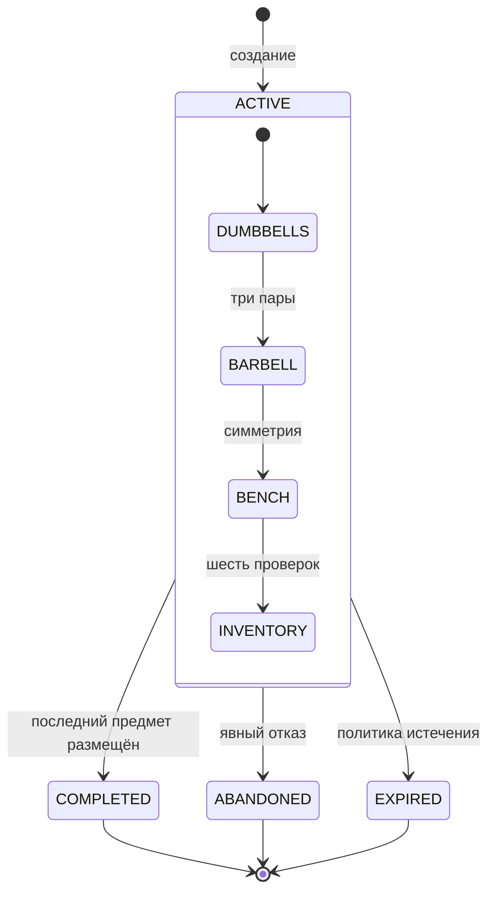
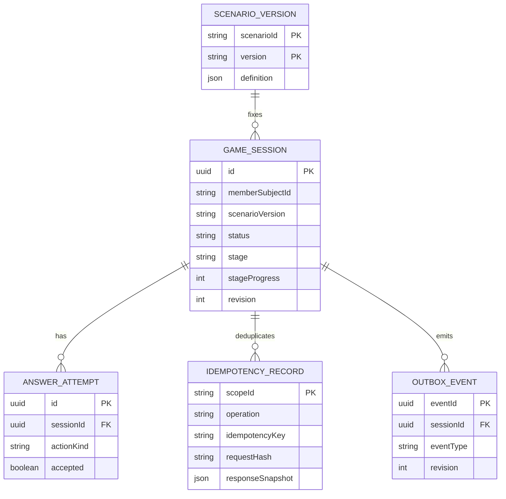

# Системная спецификация

[← Первый подход](../../README.md) · [Продуктовая постановка](../ba/README.md) · [Прототип](../demo/README.md)

Этот документ описывает **один возможный способ реализовать «Первый подход»** в мобильном приложении: игровые состояния, действия, данные и обмен событиями. Это не описание существующих микросервисов DDX. Архитектура имеет смысл только после проверки [продуктовой гипотезы](../ba/README.md).

## Состав решения и границы

Мобильный интерфейс показывает станции и собирает действия пользователя. Предлагаемый игровой backend хранит состояние и проверяет игровые правила. Существующие механизмы членства, записи на занятия и подтверждения посещений остаются вне игрового домена.

Это **логические границы ответственности**, а не найденные в инфраструктуре DDX сервисы. Разрешённые интеграции и действительный маршрут записи неизвестны.

## Четыре станции

Версия `scenarioVersion` определяет последовательность и набор игровых действий. Правильное действие продвигает прогресс, неправильное возвращает учебное объяснение и не меняет позицию.

| Stage | Действие | Критерий завершения |
|---|---|---|
| `DUMBBELLS` | Разместить пары 8/12/16 кг по подписанным ячейкам | Все три пары в соответствующих зонах |
| `BARBELL` | Выбрать сторону для четырёх виртуальных дисков | Слева и справа по 5 + 10 кг |
| `BENCH` | Последовательно выбрать проверки знакомства с неизвестной скамьёй | Все шесть шагов пройдены |
| `INVENTORY` | Отправить восемь предметов в четыре обозначенные зоны | Каждый предмет в своей зоне |

Шесть проверок скамьи: оборудование свободно → нет нагрузки → найдена инструкция модели → при сомнении обратиться к тренеру → не применять силу к неизвестному механизму → убедиться в фиксации и устойчивости. Последовательность — условная игровая модель, а не инструкция по регулировке конкретной скамьи.

Пример закреплённого контента: [`scenario-v1.sample.json`](contracts/scenario-v1.sample.json).

## Требования к поведению

Ниже — краткое резюме поведения по группам; устойчивые идентификаторы системных требований (`SA-01…SA-08`) и их связи с BA/AC сохранены в разворачиваемой матрице ниже.

| ID | Условие |
|---|---|
| Добровольность | Вход в игру доброволен; отказ не ограничивает подписку и приложение |
| Станции | Приложение показывает четыре станции и понятное объяснение ошибочного действия |
| Сохранение | Сервер сохраняет принятую позицию и позволяет её восстановить |
| Версия | В одной активной сессии применяется зафиксированная версия сценария |
| Ревизия | Одно правильное действие увеличивает `revision` ровно на 1; неверное не продвигает |
| Повтор | Повтор команды не вызывает второй переход или второе событие |
| Доступ | Доступ к чужой сессии запрещён; идентификатор участника берётся из доверенного контекста |
| CTA | CTA к действующей записи доступен независимо от прохождения игры |
| Границы | Игровой модуль не изменяет членство и не создаёт бронирование |
| События | Регистрируются разные события показа, игры, CTA, брони и фактического посещения |

Клавиатурный и мобильный ввод, текстовые сообщения об ошибках и сохранение фокуса требуют отдельной UX-приёмки. Численные SLA и сроки хранения не устанавливаются без эксплуатационного контекста.

## Состояния игровой сессии

`status` — жизненный цикл всей сессии; `stage` и `stageProgress` — положение внутри игры.

Внутри активной станции прогресс обновляется **после каждого принятого действия**. Неправильное игровое действие остаётся в текущем состоянии с пояснением. После терминального статуса новые игровые действия запрещены. Нажатие CTA — навигация клиента, **не переход состояния игры**.

**Инварианты:**
- Не более одной `ACTIVE`-сессии для одного участника; уникальность обеспечивается транзакционно.
- `scenarioVersion` фиксируется при старте; клиент запрашивает именно эту версию.
- `revision` монотонно увеличивается при подтверждённом переходе.
- Идентичный `Idempotency-Key` и payload возвращают ранее сохранённый результат.
- Устаревшая `expectedRevision` с новым ключом даёт `409 STALE_REVISION`; использованный ключ с другим payload — `409 IDEMPOTENCY_KEY_REUSED`.
- При завершении игры создаётся только одно доменное событие завершения.
- Закрытие приложения не стирает сохранённую на сервере сессию. Текущее демо отдельно хранит данные только в браузере.

## Модель данных

`memberSubjectId` — ссылка на внешнюю идентичность, не копия профиля. В игровой БД нет платежей, данных InBody или истории бронирований. `SCENARIO_VERSION` неизменяема для активных сессий. Запись состояния, результата идемпотентности и исходящего события должна быть согласованной; transactional outbox — **предлагаемый вариант**, не утверждение о технологиях компании.

Для операции старта ключ идемпотентности должен быть уникален в области `memberSubjectId + START`, поскольку `sessionId` ещё нет. Для действий — в области сессии и операции. Физическая схема, TTL ключей и retention остаются открытыми.

## Контракт API

[**OpenAPI 3.0.3**](contracts/openapi.yaml) описывает проектные маршруты; это интерфейс для возможного сервера, **не действующий API DDX**.

| Метод | Маршрут | Назначение |
|---|---|---|
| GET | `/v1/onboarding/overview` | Доступность предложения и активная сессия |
| POST | `/v1/onboarding/sessions` | Начало игровой сессии |
| GET | `/v1/onboarding/sessions/{sessionId}` | Авторитетное сохранённое состояние |
| GET | `/v1/onboarding/scenarios/{scenarioVersion}` | Закреплённая версия содержания станций |
| POST | `/v1/onboarding/sessions/{sessionId}/answers` | Одно типизированное игровое действие |
| POST | `/v1/onboarding/sessions/{sessionId}/abandon` | Явный отказ от текущей сессии |

Для `answers` предусмотрены четыре варианта команды: `DUMBBELL_PLACEMENT`, `BARBELL_PLACEMENT`, `BENCH_CHECK`, `INVENTORY_PLACEMENT`. Ответ включает `accepted`, `feedback`, актуальную `session`. Учебно неправильный ответ возвращает `200 accepted=false`, а ошибки протокола/состояния — `4xx` с машиночитаемым `code`.

**Пример сетевого повтора:** клиент отправляет действие для `revision=1`; сервер принимает его и сохраняет `revision=2`, но HTTP-ответ теряется. Клиент повторяет тот же запрос с прежним `Idempotency-Key` и получает сохранённый ответ — без второго размещения. Новый ключ со старой ревизией возвращает конфликт.

## Продуктовые события

| Источник | События | Что означают |
|---|---|---|
| Мобильный клиент | `onboarding_offer_exposed`, `intro_cta_clicked` | Показ и попытка перейти к записи |
| Игровой домен | `game_session_started`, `game_stage_completed`, `game_session_completed` | Факты игрового процесса |
| Существующая запись | `intro_booking_confirmed` | Подтверждённое бронирование |
| Существующий учёт посещений | `intro_attendance_confirmed` | Занятие фактически состоялось для участника |

Игровой домен не может самостоятельно подтвердить запись или посещение. Для оценки эффекта требуется согласованная связь идентификатора участника и экспериментальной группы с данными действующих систем. Доменные события описаны в [JSON Schema](contracts/events.schema.json), без имени, телефона и медицинских данных. Возможны повторные доставки; потребителю нужна дедупликация по `eventId`.

## Приёмка: ключевые группы сценариев

| Проверка | Ожидаемый результат |
|---|---|
| Начало / повтор старта | Создана одна `ACTIVE`-сессия; повтор с новым ключом при активной сессии даёт конфликт |
| Неверная ячейка или зона | Объяснение, без продвижения, предыдущий прогресс сохранён |
| Симметрия дисков / порядок проверок | Нельзя завершить станцию до выполнения условий |
| Последний предмет инвентаря | `COMPLETED`, одно событие завершения, результат доступен |
| Ответ сервера потерян | Повтор с тем же ключом не меняет состояние второй раз |
| Одновременные действия двух устройств | Один переход, второму `409 STALE_REVISION` |
| Устаревшая версия позиции | `409 POSITION_MISMATCH` / актуальное состояние |
| Изменённый payload при прежнем idem-key | `409 IDEMPOTENCY_KEY_REUSED` |
| Действие в терминальную сессию | `409 SESSION_TERMINAL`, изменений нет |
| Попытка открыть чужую сессию | `404` без передачи чужих данных |
| Перезапуск клиента | Восстановление состояния и закреплённого сценария |
| Пропуск игры / любой тариф | Никаких новых ограничений членства |
| CTA до старта и в процессе | Навигация доступна без завершения; прогресс сохраняется |
| Отсутствие свободных мест | Нет фиктивной записи, состояние игры не меняется |
| Аналитика / контрольная группа | Клик не считается записью; запись не считается посещением |

**Граница тестирования:** [браузерное демо](../demo/README.md) проверяет пользовательские действия и локальный прогресс, но не подтверждает серверную авторизацию, транзакции и конкурентные запросы. Для них нужен test backend или контрактный fake. Автоматические проверки репозитория запускаются через GitHub Actions.

## Открытые интеграционные вопросы

Текущие UI-маршруты записи; реальный источник attendance; принадлежность продуктового сценария; условия допуска к игре; ёмкость расписания; авторизация; правила хранения; способ A/B-назначения; методическое согласование текста и иллюстраций. Их нельзя заменить выдуманными названиями внутренних сервисов.

## Приложения к системной спецификации

Разделы выше описывают архитектурное решение. Ниже сохранены подробные **проверяемые артефакты**, которым соответствуют идентификаторы BA и контракт OpenAPI. Приёмочные условия относятся к предполагаемой клиент-серверной реализации, не к одному лишь браузерному демо.

<strong>Traceability · SA-01…SA-08 и связи BA → SA → AC</strong>

## Traceability: BA → SA → acceptance

| SA ID | Derived from | System behavior | Acceptance |
|---|---|---|---|
| SA-01 | FR-01/02, RL-01/05 | Отдельный признак допуска к предложению игры, возможность пропуска без изменения членства | AC-15/16/17 |
| SA-02 | FR-03/04, BG-02 | Четыре интерактивные станции, валидация действий сервером, объяснение без ложного продвижения | AC-03…09 |
| SA-03 | FR-05/10 | Восстановление принятого состояния, version pin, optimistic concurrency, идемпотентность | AC-01/02/10…12 |
| SA-04 | FR-07, RL-02/06 | Игра не выдаёт допуск; игровые шаги не изображают реальные инструкции к конкретному тренажёру | AC-19 |
| SA-05 | FR-06/07/11, RL-03 | CTA доступен без прохождения игры и передаёт управление штатной навигации, без создания бронирования | AC-13/14/25/26 |
| SA-06 | FR-08, RL-04 | Источники событий и их семантика разделены, идентификаторы согласованы | AC-18 |
| SA-07 | FR-09 | Назначение экспериментальной группы до показа; control не видит предложение | AC-17 |
| SA-08 | NFR-01/03/04 | Доступность ввода, безопасность владения сессией, запрет клиентского memberId | AC-20/21 |

<strong>Acceptance Criteria · полный набор AC-01…AC-26</strong>

Объект проверки: **предлагаемый сервис + клиент**, а не локальный прототип; мок подтверждает только пользовательский интерактивный путь.

| ID | Given / When | Expected result |
|---|---|---|
| AC-01 | Нет активной сессии; POST start | 201, ACTIVE/DUMBBELLS, stageProgress=0, revision=1 |
| AC-02 | Активная сессия существует; start с новым ключом | 409 ACTIVE_SESSION_EXISTS; старую сессию можно открыть |
| AC-03 | DUMBBELLS: пара 8 кг помещена не в RACK_8 | 200 accepted=false, объяснение, без продвижения и новой revision |
| AC-04 | Три пары гантелей размещены в соответствующие ячейки | Переход в BARBELL, событие завершения станции |
| AC-05 | BARBELL: одна из сторон не собрана или асимметрична | Станция не завершается |
| AC-06 | BARBELL: по 5+10 кг на обеих виртуальных сторонах | Переход в BENCH |
| AC-07 | BENCH: пропущен шаг из шести или действие не по сценарию | Обратная связь; этап не завершается |
| AC-08 | BENCH: все шесть логических проверок пройдены | Переход в INVENTORY |
| AC-09 | INVENTORY: восемь предметов разложены верно | COMPLETED, только один `game_session_completed`, CTA |
| AC-10 | Ответ на action потерялся; повтор тот же key + body | Побочный эффект не повторён; возвращён прежний responseSnapshot |
| AC-11 | Два устройства шлют action с одинаковой revision и разными ключами | Один переход, другой 409 STALE_REVISION |
| AC-12 | После перезапуска приложения GET session | Состояние и версия сценария совпадают с серверными |
| AC-13 | Нажат CTA Smart Start | Открывается согласованный маршрут существующей записи; Game API не создаёт booking |
| AC-14 | На вводное занятие нет доступных мест | Сессия остаётся COMPLETED, клиент не показывает фальшивого подтверждения |
| AC-15 | Игрок пропускает карточку | Членство и основные функции приложения не ограничены |
| AC-16 | Участники разных тарифов допущены к функции | Доступ к обучающей игре не зависит от paywall |
| AC-17 | Пользователь назначен группе A | Игра не предлагается; назначение закреплено |
| AC-18 | Пользователь нажал CTA, но запись не подтверждена | Нет `intro_booking_confirmed` / `intro_attendance_confirmed` |
| AC-19 | Завершена игра | Нет выдачи «допуска»/квалификации; тексты отсылают к тренеру и инструкции модели |
| AC-20 | Запрошена сессия другого участника | 404 без выдачи чужих данных |
| AC-21 | Управление со смартфона/клавиатуры; ответ ошибочен | Станции доступны, ошибка читается текстом и фокус не теряется |
| AC-22 | Использован прежний Idempotency-Key с другим payload | 409 IDEMPOTENCY_KEY_REUSED, нет эффекта |
| AC-23 | Одна станция завершилась, затем POST с прошлым stage | 409 POSITION_MISMATCH; получено актуальное состояние |
| AC-24 | Завершённая/заброшенная сессия получает новый action | 409 SESSION_TERMINAL, состояние не меняется |
| AC-25 | Пользователь нажал CTA на стартовом предложении, не начав игру | Доступна штатная навигация; создание игровой сессии не требуется |
| AC-26 | Пользователь нажал CTA с незавершённой игрой | Текущий stage/progress не меняется; переход к записи не блокируется |

**Разделение ошибок:** неправильное игровое действие — `200 accepted=false` с учебным объяснением; нарушение системных предусловий — `4xx` и машинный `code`.

**Test plan:** для AC-10/11/20/22/23/24 нужен сервер или контрактный fake; браузерный localStorage-прототип не подтверждает сетевую семантику.

<strong>Transitions · guards, effects, race conditions</strong>

## Transition semantics

| Trigger | Guard | Effect |
|---|---|---|
| `start` | Eligible, no ACTIVE session | Create ACTIVE; DUMBBELLS; stageProgress=0; revision=1; pinned scenarioVersion |
| `submitAction`, correct | ACTIVE; correct stage; current revision; action matches current scenario | Persist accepted action; advance progress/stage; revision+1; emit outbox event when stage/session completes |
| `submitAction`, incorrect | Same preconditions; answer is a valid but wrong game action | accepted=false; explanatory feedback; same stage/progress/revision; attempt may be recorded |
| `submitAction`, stale | expectedRevision != persisted revision, new idempotency key | 409 STALE_REVISION; no transition |
| `submitAction`, replay | Same idempotency key and payload | Return persisted previous result before re-evaluating revision; no new attempt/event |
| `submitAction`, reused key with changed payload | Key already bound to different payload | 409 IDEMPOTENCY_KEY_REUSED; no effect |
| `abandon` | ACTIVE + current revision | ABANDONED; revision+1 |
| `expire` | ACTIVE + configured expiry policy | EXPIRED; revision+1; policy defined later |
| `CTA` | Any stage or no game session | Client navigation only; no session change and no booking write |

## Consistency constraints

| Invariant | Предложенный механизм |
|---|---|
| Сценарий нельзя переписать в активной сессии | FK (`scenarioId`, `scenarioVersion`) → неизменяемая `SCENARIO_VERSION` |
| Один ACTIVE на участника | Частичный уникальный индекс по `memberSubjectId WHERE status='ACTIVE'` |
| Корректный stage/status/progress | CHECK и серверная state machine; после COMPLETED stage = null |
| Повтор безопасен | UNIQUE(`sessionId`, `operation`, `idempotencyKey`), hash payload, сохранённый responseSnapshot |
| Потеря ответа не создаёт новый переход | Одна транзакция: update с revision check + attempt + idem result + outbox |
| Нет чужого доступа | Сопоставление `memberSubjectId` с авторизованным subject на каждом GET/POST |
| Доставка событий отдельно от изменения сессии | Transactional outbox **как один из вариантов**, не как утверждение о технологии DDX |

**Для `start`:** сессии ещё нет, поэтому запись идемпотентности должна иметь scope `(memberSubjectId, 'START', idempotencyKey)` отдельно от scope действий сессии. В конкретной физической схеме можно использовать общий idempotency store с полем `scopeId`; изображённая ERD показывает прежде всего действия уже созданной сессии.

<strong>Event catalogue · ownership, attribution and delivery</strong>

События **игрового домена** и **существующих систем DDX** не взаимозаменяемы. Имена ниже проектные.

| Event | Источник истины | Что подтверждает | Чего не подтверждает |
|---|---|---|---|
| `onboarding_offer_exposed` | Мобильный клиент/аналитика показов | Пользователю показан вход в онбординг | Пользователь его прочитал |
| `game_session_started` | Proposed Game API | Сессия создана | Пользователь освоил правила |
| `game_stage_completed` | Proposed Game API | Пройден этап | Пользователь умеет пользоваться реальным оборудованием |
| `game_session_completed` | Proposed Game API | Завершены все четыре станции | Пользователь записался к тренеру |
| `game_session_abandoned` / `game_session_expired` | Proposed Game API | Терминальный исход | Мотив прекращения |
| `intro_cta_clicked` | Мобильный клиент | Пользователь попытался перейти к вводным услугам | Открылось расписание, есть слот или бронь |
| `intro_booking_confirmed` | Existing booking | Запись подтверждена | Клиент действительно пришёл |
| `intro_attendance_confirmed` | Existing attendance | Фактическое участие подтверждено | Влияние игры без контрольной группы |

## Связь событий

Пользователь рандомизируется до `onboarding_offer_exposed`. Одна единица рандомизации (`memberSubjectId`) сопоставляется с назначением A/B/C в аналитическом контуре. `game_session_id` связывает технические события игры. Факт занятия подтверждается **только** существующим источником посещений; идентификаторы и путь выгрузки согласовываются с DDX.

**Privacy boundary:** игровые domain events содержат `sessionId` и `scenarioVersion`, но не имя, телефон, данные InBody или сырой атрибут подписки. Связь `sessionId ↔ memberSubjectId` хранится в защищённом серверном контуре и не должна внедряться в публичный payload без согласования.

## Delivery semantics

Если выбран outbox, запись нового состояния и события выполняется атомарно, публикация допускает повторную доставку; потребитель дедуплицирует по `eventId`. Порядок событий внутри сессии можно восстанавливать по `revision`; глобальный порядок не обещается.

## Ключевые проверки

- Идемпотентный повтор accepted-action не создаёт второго `game_stage_completed`.
- Повторный показ CTA не меняет `game_session_completed`.
- Отсутствие `intro_attendance_confirmed` запрещает считать `intro_cta_clicked` посещением.
- Участник контрольной группы A входит в denominator ITT, даже если игру никогда не видел.

<strong>Open Questions · OQ-01…OQ-12, причины и адресаты</strong>

Ни одна из гипотетических внутренних границ ниже не заявляется существующей внутри DDX.

| ID | Вопрос | Почему блокирует решение | Кому адресовать |
|---|---|---|---|
| OQ-01 | Как сегодня показываются Smart Start/ознакомительные занятия после покупки? | Может устранить исходную проблему ещё до MVP | Product / UX |
| OQ-02 | Есть ли baseline awareness → booking → attendance по новым членам? | Нельзя обосновать метрику и MDE | Product analytics |
| OQ-03 | Кто отвечает за новый онбординг и его outcome? | Нет владельца приоритизации | Product leadership |
| OQ-04 | Какое основание/маршрут позволяет открыть существующий экран записи? | Нельзя проектировать CTA или deep link без контракта | Mobile / booking |
| OQ-05 | Где берётся подтверждение фактического посещения вводного занятия? | Иначе измеряются только клики | Booking / attendance / analytics |
| OQ-06 | Как учитываются eligibility, клуб, расписание, число мест и ограничения ознакомительной тренировки? | Возникает логическая ошибка между рекомендацией и доступностью | Operations / booking |
| OQ-07 | Как выглядит фактическая архитектурная граница мобильного приложения и backend? | Предлагаемый Game API может оказаться избыточным | Architecture / mobile |
| OQ-08 | Каковы реальные identity, privacy, retention и experiment-assignment правила? | Контракты невозможно выпускать в production | Security / platform / data |
| OQ-09 | Кто утверждает содержание и права на графику/модели инвентаря? | Недопустимы неточные инструкции к оборудованию | Training / legal / content |
| OQ-10 | Как работает сессия при выключении feature flag или смене версии сценария? | Нужна согласованная политика миграции/дожития сессии | Product / backend |
| OQ-11 | Какие ограничения у мобильного стека, дизайн-системы и способов интеракции? | Нельзя обещать 3D и производительность без оценки | Mobile |
| OQ-12 | Есть ли ёмкость у Smart Start, чтобы выдержать дополнительный спрос? | Дополнительная реклама без доступных слотов ухудшает UX | Operations |

**Decision gate:** пока OQ-01/02/06 не закрыты, рекомендовать только discovery и лёгкий эксперимент с информационной карточкой; не утверждать, что DDX необходим отдельный игровой сервис.

---

[← Описание продукта](../../README.md) · [BA: постановка и эксперимент](../ba/README.md) · [Код и запуск демо](../demo/README.md)
