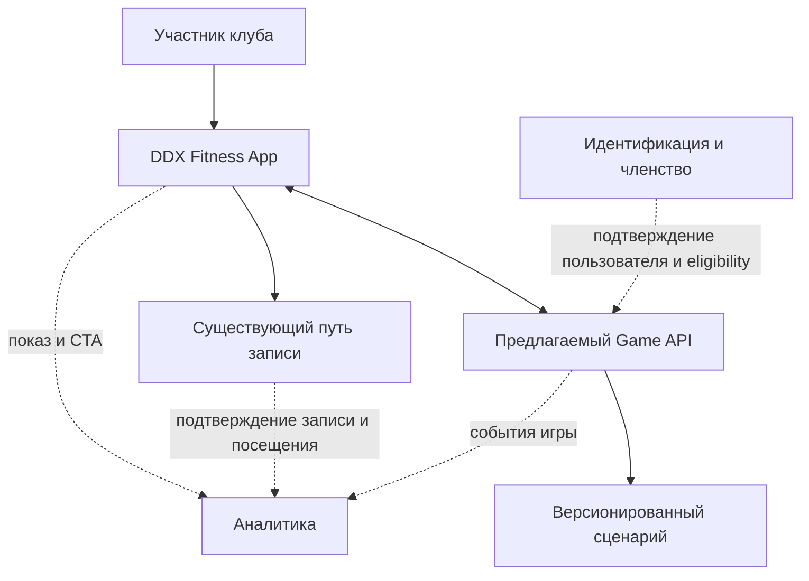
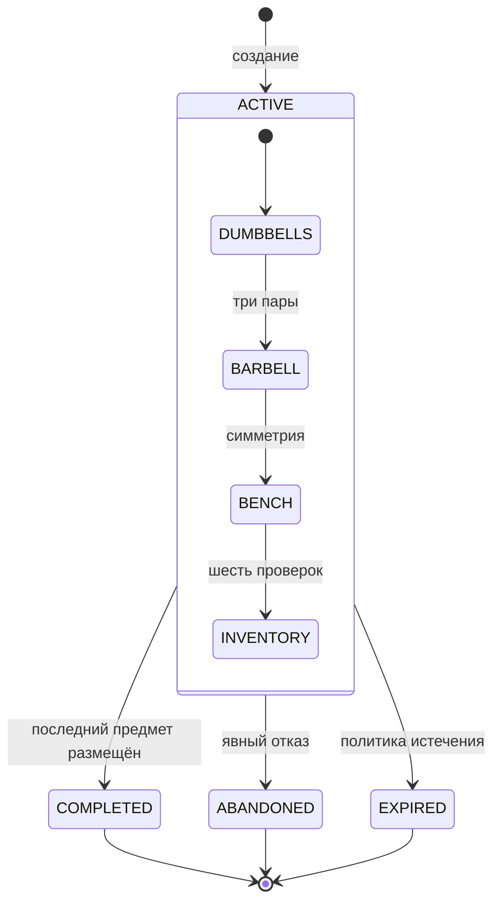
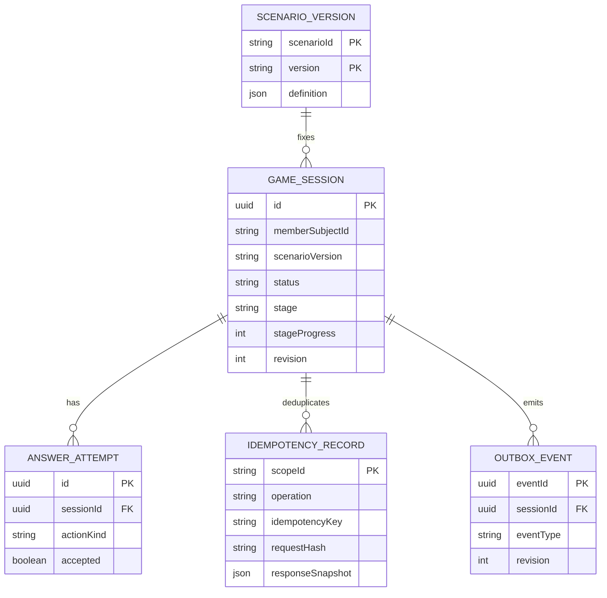

# Системная спецификация

[← Первый подход](../../README.md) · [Продуктовая постановка](../ba/README.md) · [Прототип](../demo/README.md)

Этот документ описывает **один возможный способ реализовать «Первый подход»** в мобильном приложении: игровые состояния, действия, данные и обмен событиями. Это не описание существующих микросервисов DDX. Архитектура имеет смысл только после проверки [продуктовой гипотезы](../ba/README.md).

## Состав решения и границы

Мобильный интерфейс показывает станции и собирает действия пользователя. Предлагаемый игровой backend хранит состояние и проверяет игровые правила. Существующие механизмы членства, записи на занятия и подтверждения посещений остаются вне игрового домена.

Это **логические границы ответственности**, а не найденные в инфраструктуре DDX сервисы. Разрешённые интеграции и действительный маршрут записи неизвестны.

## Четыре станции

Версия `scenarioVersion` определяет последовательность и набор игровых действий. Правильное действие продвигает прогресс, неправильное возвращает учебное объяснение и не меняет позицию.

| Stage | Действие | Критерий завершения |
|---|---|---|
| `DUMBBELLS` | Разместить пары 8/12/16 кг по подписанным ячейкам | Все три пары в соответствующих зонах |
| `BARBELL` | Выбрать сторону для четырёх виртуальных дисков | Слева и справа по 5 + 10 кг |
| `BENCH` | Последовательно выбрать проверки знакомства с неизвестной скамьёй | Все шесть шагов пройдены |
| `INVENTORY` | Отправить восемь предметов в четыре обозначенные зоны | Каждый предмет в своей зоне |

Шесть проверок скамьи: оборудование свободно → нет нагрузки → найдена инструкция модели → при сомнении обратиться к тренеру → не применять силу к неизвестному механизму → убедиться в фиксации и устойчивости. Последовательность — условная игровая модель, а не инструкция по регулировке конкретной скамьи.

Пример закреплённого контента: [`scenario-v1.sample.json`](contracts/scenario-v1.sample.json).

## Требования к поведению

| ID | Условие |
|---|---|
| SR-01 | Вход в игру доброволен; отказ не ограничивает подписку и приложение |
| SR-02 | Приложение показывает четыре станции и понятное объяснение ошибочного действия |
| SR-03 | Сервер сохраняет принятую позицию и позволяет её восстановить |
| SR-04 | В одной активной сессии применяется зафиксированная версия сценария |
| SR-05 | Одно правильное действие увеличивает `revision` ровно на 1; неверное не продвигает |
| SR-06 | Повтор команды не вызывает второй переход или второе событие |
| SR-07 | Доступ к чужой сессии запрещён; идентификатор участника берётся из доверенного контекста |
| SR-08 | CTA к действующей записи доступен независимо от прохождения игры |
| SR-09 | Игровой модуль не изменяет членство и не создаёт бронирование |
| SR-10 | Регистрируются разные события показа, игры, CTA, брони и фактического посещения |

Клавиатурный и мобильный ввод, текстовые сообщения об ошибках и сохранение фокуса требуют отдельной UX-приёмки. Численные SLA и сроки хранения не устанавливаются без эксплуатационного контекста.

## Состояния игровой сессии

`status` — жизненный цикл всей сессии; `stage` и `stageProgress` — положение внутри игры.

Внутри активной станции прогресс обновляется **после каждого принятого действия**. Неправильное игровое действие остаётся в текущем состоянии с пояснением. После терминального статуса новые игровые действия запрещены. Нажатие CTA — навигация клиента, **не переход состояния игры**.

**Инварианты:**
- Не более одной `ACTIVE`-сессии для одного участника; уникальность обеспечивается транзакционно.
- `scenarioVersion` фиксируется при старте; клиент запрашивает именно эту версию.
- `revision` монотонно увеличивается при подтверждённом переходе.
- Идентичный `Idempotency-Key` и payload возвращают ранее сохранённый результат.
- Устаревшая `expectedRevision` с новым ключом даёт `409 STALE_REVISION`; использованный ключ с другим payload — `409 IDEMPOTENCY_KEY_REUSED`.
- При завершении игры создаётся только одно доменное событие завершения.
- Закрытие приложения не стирает сохранённую на сервере сессию. Текущее демо отдельно хранит данные только в браузере.

## Модель данных

`memberSubjectId` — ссылка на внешнюю идентичность, не копия профиля. В игровой БД нет платежей, данных InBody или истории бронирований. `SCENARIO_VERSION` неизменяема для активных сессий. Запись состояния, результата идемпотентности и исходящего события должна быть согласованной; transactional outbox — **предлагаемый вариант**, не утверждение о технологиях компании.

Для операции старта ключ идемпотентности должен быть уникален в области `memberSubjectId + START`, поскольку `sessionId` ещё нет. Для действий — в области сессии и операции. Физическая схема, TTL ключей и retention остаются открытыми.

## Контракт API

[**OpenAPI 3.0.3**](contracts/openapi.yaml) описывает проектные маршруты; это интерфейс для возможного сервера, **не действующий API DDX**.

| Метод | Маршрут | Назначение |
|---|---|---|
| GET | `/v1/onboarding/overview` | Доступность предложения и активная сессия |
| POST | `/v1/onboarding/sessions` | Начало игровой сессии |
| GET | `/v1/onboarding/sessions/{sessionId}` | Авторитетное сохранённое состояние |
| GET | `/v1/onboarding/scenarios/{scenarioVersion}` | Закреплённая версия содержания станций |
| POST | `/v1/onboarding/sessions/{sessionId}/answers` | Одно типизированное игровое действие |
| POST | `/v1/onboarding/sessions/{sessionId}/abandon` | Явный отказ от текущей сессии |

Для `answers` предусмотрены четыре варианта команды: `DUMBBELL_PLACEMENT`, `BARBELL_PLACEMENT`, `BENCH_CHECK`, `INVENTORY_PLACEMENT`. Ответ включает `accepted`, `feedback`, актуальную `session`. Учебно неправильный ответ возвращает `200 accepted=false`, а ошибки протокола/состояния — `4xx` с машиночитаемым `code`.

**Пример сетевого повтора:** клиент отправляет действие для `revision=1`; сервер принимает его и сохраняет `revision=2`, но HTTP-ответ теряется. Клиент повторяет тот же запрос с прежним `Idempotency-Key` и получает сохранённый ответ — без второго размещения. Новый ключ со старой ревизией возвращает конфликт.

## Продуктовые события

| Источник | События | Что означают |
|---|---|---|
| Мобильный клиент | `onboarding_offer_exposed`, `intro_cta_clicked` | Показ и попытка перейти к записи |
| Игровой домен | `game_session_started`, `game_stage_completed`, `game_session_completed` | Факты игрового процесса |
| Существующая запись | `intro_booking_confirmed` | Подтверждённое бронирование |
| Существующий учёт посещений | `intro_attendance_confirmed` | Занятие фактически состоялось для участника |

Игровой домен не может самостоятельно подтвердить запись или посещение. Для оценки эффекта требуется согласованная связь идентификатора участника и экспериментальной группы с данными действующих систем. Доменные события описаны в [JSON Schema](contracts/events.schema.json), без имени, телефона и медицинских данных. Возможны повторные доставки; потребителю нужна дедупликация по `eventId`.

## Приёмка: ключевые группы сценариев

| Проверка | Ожидаемый результат |
|---|---|
| Начало / повтор старта | Создана одна `ACTIVE`-сессия; повтор с новым ключом при активной сессии даёт конфликт |
| Неверная ячейка или зона | Объяснение, без продвижения, предыдущий прогресс сохранён |
| Симметрия дисков / порядок проверок | Нельзя завершить станцию до выполнения условий |
| Последний предмет инвентаря | `COMPLETED`, одно событие завершения, результат доступен |
| Ответ сервера потерян | Повтор с тем же ключом не меняет состояние второй раз |
| Одновременные действия двух устройств | Один переход, второму `409 STALE_REVISION` |
| Устаревшая версия позиции | `409 POSITION_MISMATCH` / актуальное состояние |
| Изменённый payload при прежнем idem-key | `409 IDEMPOTENCY_KEY_REUSED` |
| Действие в терминальную сессию | `409 SESSION_TERMINAL`, изменений нет |
| Попытка открыть чужую сессию | `404` без передачи чужих данных |
| Перезапуск клиента | Восстановление состояния и закреплённого сценария |
| Пропуск игры / любой тариф | Никаких новых ограничений членства |
| CTA до старта и в процессе | Навигация доступна без завершения; прогресс сохраняется |
| Отсутствие свободных мест | Нет фиктивной записи, состояние игры не меняется |
| Аналитика / контрольная группа | Клик не считается записью; запись не считается посещением |

**Граница тестирования:** [браузерное демо](../demo/README.md) проверяет пользовательские действия и локальный прогресс, но не подтверждает серверную авторизацию, транзакции и конкурентные запросы. Для них нужен test backend или контрактный fake. Автоматические проверки репозитория запускаются через GitHub Actions.

## Открытые интеграционные вопросы

Текущие UI-маршруты записи; реальный источник attendance; принадлежность продуктового сценария; условия допуска к игре; ёмкость расписания; авторизация; правила хранения; способ A/B-назначения; методическое согласование текста и иллюстраций. Их нельзя заменить выдуманными названиями внутренних сервисов.

---

[← Описание продукта](../../README.md) · [BA: постановка и эксперимент](../ba/README.md) · [Код и запуск демо](../demo/README.md)
