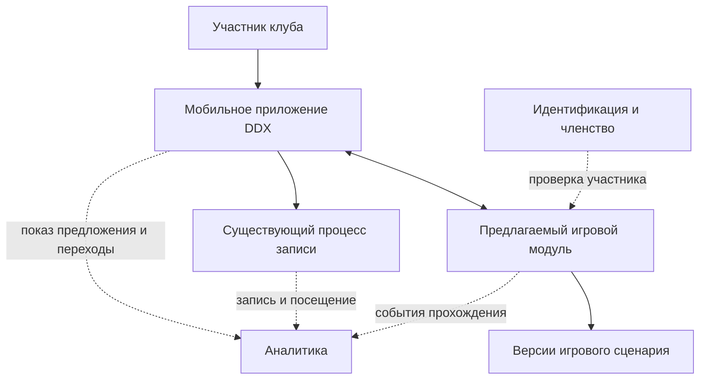
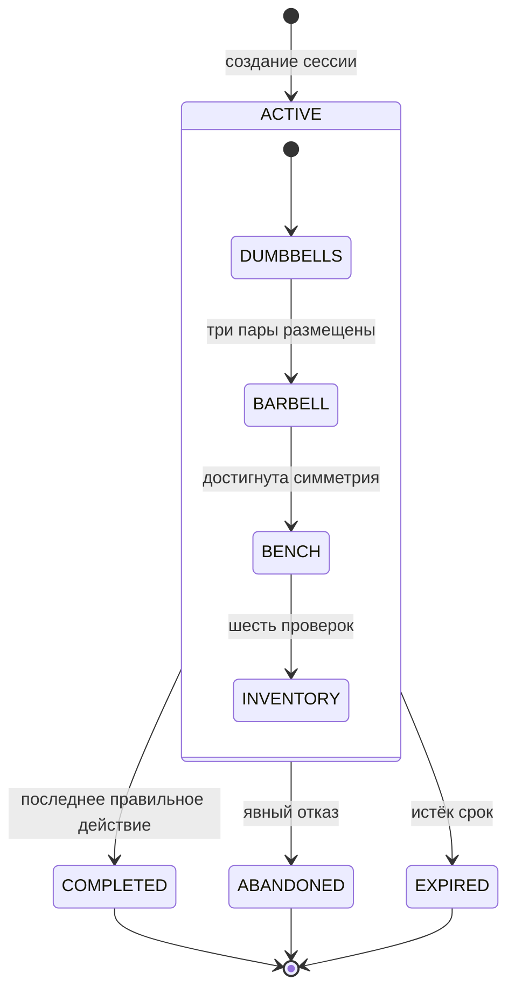
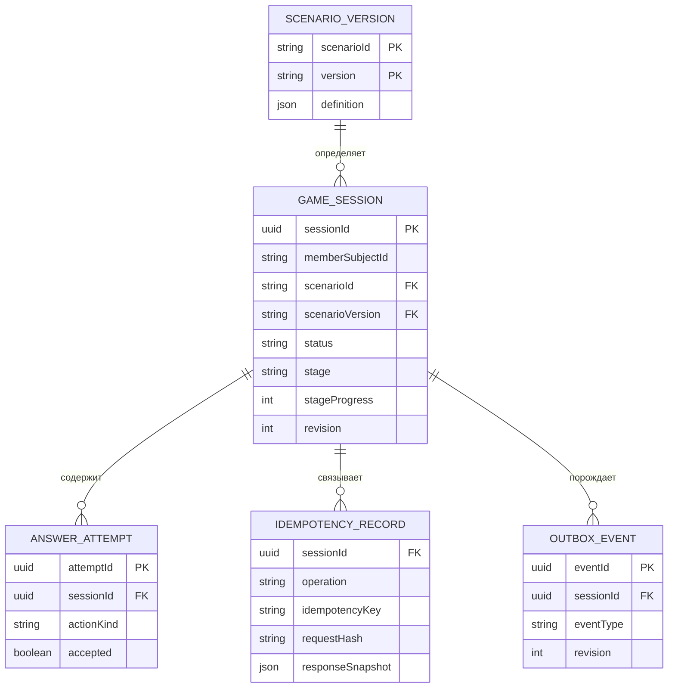

# Системный анализ · «Первый подход»

[← Описание продукта](../../README.md) · [Бизнес-анализ](../ba/README.md) · [Интерактивный прототип](../demo/README.md)

Документ описывает **предлагаемый вариант технической реализации** четырёх станций «Первого подхода»: системные границы, правила обработки действий, модель данных, интерфейс взаимодействия и критерии приёмки. Требования выведены из [продуктовой постановки](../ba/README.md). Реальная внутренняя архитектура DDX неизвестна; проектные компоненты нельзя считать существующими сервисами компании.

## 1. Системный контекст

Мобильное приложение показывает игровые задания и передаёт действия предлагаемому игровому модулю. Модуль проверяет правила, сохраняет состояние и формирует игровые события. Авторизация, членство, расписание, запись на занятия и подтверждение посещения относятся к **существующим процессам сети**, которые проектом не заменяются.

**Граница ответственности:** игра не создаёт и не подтверждает бронь. Факт посещения может поступать только из согласованного источника учёта посещений. Направления интеграции на схеме — проектное предположение.

## 2. Игровой сценарий

Версия `scenarioVersion` задаёт состав и порядок заданий. Каждое правильное **атомарное действие** продвигает позицию участника; неправильное игровое действие возвращает объяснение без изменения принятого прогресса.

| Станция (код) | Действие | Условие завершения |
|---|---|---|
| Гантели (`DUMBBELLS`) | Распределить три пары 8, 12 и 16 кг по подписанным ячейкам | Все три пары размещены правильно |
| Штанга (`BARBELL`) | Разместить четыре виртуальных диска по сторонам грифа | На каждой стороне по одному диску 5 и 10 кг |
| Скамья (`BENCH`) | Последовательно выбрать шесть проверок перед использованием незнакомой скамьи | Все шесть шагов выполнены |
| Инвентарь (`INVENTORY`) | Распределить восемь предметов по четырём условным зонам | Все восемь предметов размещены правильно |

Для скамьи используется условная последовательность: свободная зона → отсутствие нагрузки → ознакомление с инструкцией конкретной модели → обращение к тренеру при сомнении → отказ от силового воздействия на неизвестный механизм → проверка устойчивости и фиксации. Это **не руководство по регулировке конкретной скамьи**.

Данные первого варианта сценария: [`scenario-v1.sample.json`](contracts/scenario-v1.sample.json).

## 3. Системные требования и их прослеживаемость

Каждая строка связывает **источник требования в BA**, ожидаемое **системное поведение** и **критерии приёмки**. Эти коды используются при проектировании и изменении контрактов.

| ID | Основание (BA) | Системное требование | Критерии приёмки |
|---|---|---|---|
| SA-01 | FR-01, FR-02, RL-01, RL-05 | Определять допустимость показа предложения; обеспечивать отказ без изменения членства и основных функций приложения | AC-15, AC-16, AC-17 |
| SA-02 | FR-03, FR-04, BG-02 | Проверять действия четырёх станций по закреплённому сценарию; возвращать пояснение при ошибке без ложного продвижения | AC-03—AC-09 |
| SA-03 | FR-05, FR-10 | Хранить авторитетное состояние, обеспечивать восстановление, версионирование, согласование параллельных действий и идемпотентность | AC-01, AC-02, AC-10—AC-12 |
| SA-04 | RL-02, RL-06 | Ограничивать содержание станции со скамьёй проверенными сведениями; не включать инструкции к неизвестной модели оборудования | AC-19 |
| SA-05 | FR-06, FR-07, FR-11, RL-03 | Предоставлять переход к штатной записи с предложения и во время игры, не изменяя состояние сессии и не создавая бронь | AC-13, AC-14, AC-25, AC-26 |
| SA-06 | FR-08, RL-04 | Разграничивать источники игровых событий, подтверждения брони и фактического посещения | AC-18 |
| SA-07 | FR-09 | Назначать участника в группу исследования до показа предложения и сохранять назначение | AC-17 |
| SA-08 | NFR-01, NFR-03, NFR-04 | Обеспечивать доступность управления и защиту игровых сессий по данным доверенной авторизации | AC-20, AC-21 |

**Правила проверки требований:** продуктовые цели и потребности описаны в BA; системные требования не подменяют их. Проверки AC-10, AC-11, AC-20, AC-22—AC-24 невозможно подтвердить только браузерным прототипом.

## 4. Жизненный цикл сессии

`status` — состояние игровой сессии в целом; `stage` и `stageProgress` — положение участника внутри четырёх станций. Завершение сессии не является пятой станцией.

### Переходы и условия их выполнения

| Действие | Предусловие | Результат |
|---|---|---|
| Создание сессии (`start`) | Участник допущен; нет активной сессии | `ACTIVE`, станция `DUMBBELLS`, прогресс 0, `revision=1`, закреплённая версия сценария |
| Правильное действие (`submitAction`) | Активная сессия; совпали станция, версия состояния и правила сценария | Действие сохраняется; прогресс или станция обновляются; `revision` увеличивается на 1; при завершении станции/игры формируется событие |
| Ошибочное игровое действие | Системные предусловия соблюдены, но выбран неверный игровой вариант | `accepted=false`, пояснение; станция, прогресс и `revision` не меняются |
| Запрос с устаревшей ревизией | Новый ключ повтора и несовпадающая `expectedRevision` | `409 STALE_REVISION`, переход не выполняется |
| Повтор идентичного запроса | Ключ повтора и содержимое полностью совпадают с ранее обработанными | Возвращается ранее сохранённый результат без второго действия и события |
| Повтор ключа с другими данными | Ключ использован ранее с другим содержимым | `409 IDEMPOTENCY_KEY_REUSED`, изменений нет |
| Отказ (`abandon`) | Активная сессия; текущая ревизия | `ABANDONED`, увеличение ревизии на 1 |
| Истечение срока (`expire`) | Активная сессия; наступило согласованное условие истечения | `EXPIRED`, увеличение ревизии на 1 |
| Переход к занятию | Любой этап, включая отсутствие игровой сессии | Навигация внутри приложения без изменения состояния игры или создания брони |

Срок истечения, хранение завершённых сессий и политика повторного прохождения требуют согласования.

### Инварианты согласованности

- Для одного участника допускается не более одной активной сессии; ограничение обеспечивается **на уровне хранилища**, не проверкой «прочитать перед созданием».
- Владение сессией устанавливается по доверенному идентификатору авторизации; клиент не передаёт произвольный `memberId`.
- Версия сценария фиксируется при создании сессии; уже начатое прохождение нельзя незаметно переключать на новую версию.
- Каждое принятое игровое действие увеличивает `revision` ровно на 1; неправильный вариант не изменяет позицию.
- Повтор с прежним ключом и тем же содержимым возвращает сохранённый ответ **до повторной проверки ревизии**.
- Действие с новой командой и устаревшей ревизией не применяется автоматически к новому состоянию.
- Сессии `COMPLETED`, `ABANDONED` и `EXPIRED` не принимают новые игровые действия.
- `game_session_completed` формируется не более одного раза для каждой завершённой сессии.
- При недоступности сети клиент восстанавливает подтверждённое состояние; не выдаёт локально рассчитанную позицию за серверную.

**Пример потери ответа:** сервер принимает размещение гантели при `revision=1` и сохраняет `revision=2`, но ответ не доходит до телефона. Повтор запроса с прежним `Idempotency-Key` возвращает прежний результат; второе размещение не выполняется.

## 5. Логическая модель данных

| Правило целостности | Предложенный механизм |
|---|---|
| Неизменность версии сценария для активной сессии | Составной внешний ключ `scenarioId + scenarioVersion` на неизменяемую версию |
| Единственность активной сессии | Частичный уникальный индекс по `memberSubjectId` при `status='ACTIVE'` |
| Допустимость состояния и позиции | Ограничения допустимых значений и серверный автомат состояний |
| Исключение повторного применения команды | Уникальность области применения и ключа повтора, контроль хеша запроса и сохранение ответа |
| Согласованность действия и события | Одна транзакция для изменения сессии, регистрации повтора и исходящего события |
| Изоляция данных участников | Сопоставление владельца с доверенной авторизацией при каждом обращении |
| Независимая отправка событий | Таблица исходящих событий с последующей публикацией; вариант реализации, не утверждение о DDX |

**Операция создания сессии:** пока нет `sessionId`, ключ повтора учитывается по области `(memberSubjectId, START)`. После создания действия учитываются по области конкретной сессии. Детальная физическая схема должна предусматривать обе области; приведённая модель показывает главным образом действия существующей сессии.

Данные о членстве, платежах, расписании и посещениях **не копируются в игровой модуль**. `memberSubjectId` — непрозрачная ссылка на идентичность, а не профиль. Сроки хранения, очистка данных и правила технического журналирования определяются отдельно.

## 6. Программный интерфейс

[Спецификация OpenAPI 3.0.3](contracts/openapi.yaml) описывает **предлагаемый**, а не действующий интерфейс DDX.

| Метод | Маршрут | Назначение |
|---|---|---|
| `GET` | `/v1/onboarding/overview` | Получение сведений о доступности предложения и активной сессии |
| `POST` | `/v1/onboarding/sessions` | Создание игровой сессии |
| `GET` | `/v1/onboarding/sessions/{sessionId}` | Получение подтверждённого состояния сессии |
| `GET` | `/v1/onboarding/scenarios/{scenarioVersion}` | Получение закреплённой версии сценария |
| `POST` | `/v1/onboarding/sessions/{sessionId}/answers` | Отправка одного игрового действия |
| `POST` | `/v1/onboarding/sessions/{sessionId}/abandon` | Завершение прохождения по инициативе участника |

Запрос действия содержит один из типизированных вариантов: `DUMBBELL_PLACEMENT`, `BARBELL_PLACEMENT`, `BENCH_CHECK`, `INVENTORY_PLACEMENT`. Ответ включает `accepted`, `feedback` и актуальное состояние `session`.

**Неверный выбор внутри задания** — допустимый игровой ответ `200 accepted=false`. **Нарушение системных предусловий** (владение, ревизия, позиция или конфликт ключа) — ответ соответствующего класса `4xx` с машиночитаемым кодом ошибки.

## 7. События и их источники

| Событие (имя в контракте) | Источник | Что подтверждается | Чего событие не подтверждает |
|---|---|---|---|
| `onboarding_offer_exposed` | Мобильное приложение | Показ предложения | Что участник прочёл сообщение |
| `game_session_started` | Игровой модуль | Создание сессии | Знание правил |
| `game_stage_completed` | Игровой модуль | Завершение станции | Фактический навык работы с тренажёром |
| `game_session_completed` | Игровой модуль | Завершение всех четырёх станций | Запись к тренеру |
| `game_session_abandoned`, `game_session_expired` | Игровой модуль | Завершение по отказу или сроку | Причину отказа |
| `intro_cta_clicked` | Мобильное приложение | Попытку перейти к записи | Наличие свободного места и бронь |
| `intro_booking_confirmed` | Действующий процесс записи | Подтверждённую запись | Посещение занятия |
| `intro_attendance_confirmed` | Действующий учёт посещений | Факт посещения | Причинный эффект игры без сравнения групп |

**Связь с экспериментом:** назначение варианта A/B/C хранится в согласованном аналитическом контуре и связывается с участником. Игровая сессия связывает только события прохождения. Данные записи и посещений поступают из соответствующих существующих источников.

**Доставка:** если используется таблица исходящих событий, запись результата и события должна происходить согласованно. Повторная публикация возможна; получатель устраняет дубликаты по `eventId`, а порядок внутри сессии восстанавливается по `revision`. Общий порядок событий разных сессий не гарантируется.

Структура игровых событий приведена в [JSON Schema](contracts/events.schema.json). В события не добавляются имя, телефон, результаты измерений состава тела и сведения об оплате. Нажатие кнопки не подменяет запись, а запись — посещение.

## 8. Критерии приёмки

Проверки относятся к **предлагаемому клиент-серверному решению**. Браузерный прототип может подтвердить только интерактивные действия и локальное сохранение.

| ID | Условие / действие | Ожидаемый результат |
|---|---|---|
| AC-01 | Нет активной сессии; поступил запрос на создание | `201`, `ACTIVE/DUMBBELLS`, `stageProgress=0`, `revision=1` |
| AC-02 | Активная сессия уже существует; создание с новым ключом | `409 ACTIVE_SESSION_EXISTS`; существующую сессию можно восстановить |
| AC-03 | Пара гантелей 8 кг направлена в ячейку 12 кг | `200 accepted=false`; объяснение без изменения прогресса и ревизии |
| AC-04 | Все три пары гантелей размещены правильно | Переход в `BARBELL`, однократное событие завершения станции |
| AC-05 | Диски на штанге размещены несимметрично | Завершение станции не происходит |
| AC-06 | По 5 и 10 кг размещено с каждой стороны виртуального грифа | Переход в `BENCH` |
| AC-07 | Пропущен шаг проверки скамьи либо выбран неверный вариант | Пояснение без завершения станции |
| AC-08 | Выполнены все шесть проверок скамьи | Переход в `INVENTORY` |
| AC-09 | Правильно размещены все восемь предметов инвентаря | `COMPLETED`, единственное событие `game_session_completed`, доступен итоговый экран |
| AC-10 | Ответ сервера потерян; запрос повторён с прежним ключом и тем же содержимым | Возврат сохранённого ответа без повторного действия и события |
| AC-11 | Два устройства отправляют разные действия с одинаковой ожидаемой ревизией | Применяется одно действие; второе получает `409 STALE_REVISION` |
| AC-12 | Приложение закрыто и открыто снова | Получено подтверждённое состояние и та же версия сценария |
| AC-13 | Участник нажал переход к Smart Start | Открывается согласованный путь записи; игровой модуль не создаёт бронь |
| AC-14 | В расписании нет свободных мест | Не показывается ложное подтверждение записи; игровая сессия не изменяется |
| AC-15 | Участник закрывает предложение игры | Не ограничиваются членство и основные функции приложения |
| AC-16 | Участники с различными тарифами получают предложение игры | Функция не вводит дополнительную оплату или ограничение по тарифу |
| AC-17 | Участник назначен в контрольную группу A | Предложение игры не показывается; назначение остаётся неизменным |
| AC-18 | Переход к записи выполнен, но бронь не подтверждена | Не создаются события подтверждённой записи и посещения |
| AC-19 | Четыре станции пройдены | Показана памятка; отсутствуют неподтверждённые указания по обращению с конкретным оборудованием |
| AC-20 | Запрошена чужая сессия | Ответ `404` без раскрытия чужих данных |
| AC-21 | Игровым интерфейсом управляют с клавиатуры или телефона; допущена ошибка | Действие доступно; пояснение читаемо текстом, порядок фокуса сохраняется |
| AC-22 | Старый ключ повтора использован с другим содержимым | `409 IDEMPOTENCY_KEY_REUSED` без изменения состояния |
| AC-23 | После перехода отправлено действие для предыдущей станции | `409 POSITION_MISMATCH`; текущее состояние не меняется |
| AC-24 | Новое действие отправлено в завершённую, прерванную или истёкшую сессию | `409 SESSION_TERMINAL`, изменений нет |
| AC-25 | Переход к вводному занятию выполнен до запуска игры | Открывается штатная навигация без создания игровой сессии |
| AC-26 | Переход к вводному занятию выполнен во время игры | Текущий этап и прогресс сохраняются; переход не блокируется |

**Объём проверки:** AC-10, AC-11, AC-20, AC-22, AC-23 и AC-24 требуют работающего сервера либо имитатора программного интерфейса. Наличие этих критериев не означает, что они уже выполнены браузерным прототипом.

## 9. Открытые вопросы и ответственные стороны

Роли в последней колонке — **предполагаемые адресаты согласования**, а не сведения о структуре штата DDX.

| ID | Вопрос | Почему важен | Кому адресовать |
|---|---|---|---|
| OQ-01 | Где и при каких условиях сегодня предлагаются Smart Start и ознакомительные занятия? | Возможная проблема обнаружения может отсутствовать | Ответственные за продукт и интерфейс |
| OQ-02 | Есть ли данные об осведомлённости, записи и посещениях новых участников? | Невозможно обосновать базовый показатель и размер исследования | Продуктовая аналитика |
| OQ-03 | Кто отвечает за результат первоначальной адаптации клиента? | Необходим владелец решения о развитии функции | Руководитель продуктового направления |
| OQ-04 | Каким способом приложение открывает действующий экран записи? | Нельзя определить переход без согласованного интерфейса | Разработчики приложения и записи |
| OQ-05 | Какая система подтверждает фактическое посещение вводного занятия? | Нельзя измерять только нажатия кнопок | Ответственные за запись и учёт посещений |
| OQ-06 | Как определяются клуб, условия записи, расписание и наличие мест? | Предложение игры не должно создавать ложные ожидания | Ответственные за расписание и занятия |
| OQ-07 | Как фактически разделены мобильное приложение и серверные компоненты? | Отдельный игровой сервис может оказаться избыточным | Архитектор и разработчики |
| OQ-08 | Какие правила действуют для авторизации, защиты, хранения данных и назначения групп? | Невозможно согласовать выпуск без требований платформы | Безопасность, платформа, аналитика |
| OQ-09 | Кто подтверждает корректность правил и права на графику оборудования? | Нужны проверенные материалы | Методист и ответственный за содержание |
| OQ-10 | Как обрабатывается начатая сессия после выключения функции или смены версии? | Требуется политика сохранения и завершения | Ответственные за продукт и серверную логику |
| OQ-11 | Какие ограничения действуют для интерфейса и графики мобильного приложения? | Нельзя заранее обещать трёхмерную реализацию | Разработчики мобильного приложения |
| OQ-12 | Достаточно ли мест и тренеров при возможном росте спроса? | Иначе приглашение на занятие ухудшит опыт клиента | Ответственные за проведение занятий |

**Условие перехода к разработке:** до ответа на OQ-01, OQ-02 и OQ-06 требуется исследовать текущий опыт и проверить простой информационный вариант. Создание отдельного игрового сервиса пока не обосновано.

---

[← Описание продукта](../../README.md) · [Бизнес-анализ](../ba/README.md) · [Код и запуск прототипа](../demo/README.md)
