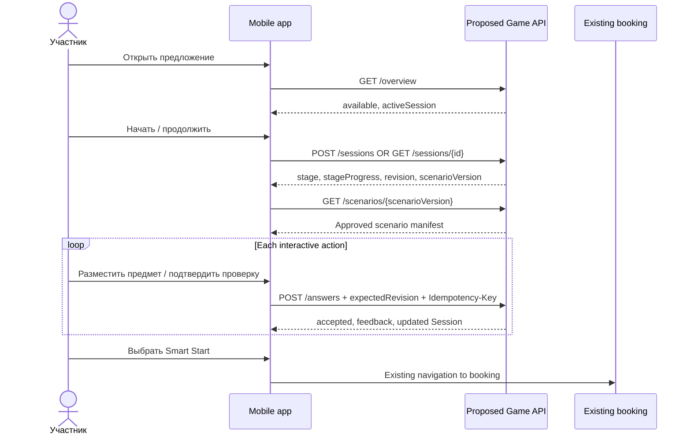

# 01 · System context (proposed)

[Кейс](../../../README.md) / [Карта артефактов](../../../NAVIGATION.md) / [SA · Системный анализ](../README.md) / **01 · System Context**

## Scope and assumptions

Цель потенциального изменения — добавить необязательный игровой сценарий в существующее DDX Fitness App **без переноса** в игру функций членства, платежей, записи, реальных посещений и InBody. Публичная информация не позволяет утверждать, что DDX располагает именно такими техническими сервисами: таблица ниже отражает **логические ответственности**.

| Logical boundary | Responsibility | Assumed interaction |
|---|---|---|
| DDX App | Пользовательский интерфейс, запуск, локальная навигация | Открывает предложение, запрашивает состояние и **версионированный** сценарий |
| Existing identity / membership | Авторизация и условия участия | Передаёт доверенный subject и решение об eligibility; реальные API неизвестны |
| Proposed game domain | Сессия, действия, валидация, revision, outbox | Проектный REST API; сохраняет только игровой прогресс |
| Approved scenario content | Неизменяемая версия заданий и методически утверждённые формулировки | `GET /v1/onboarding/scenarios/{scenarioVersion}`; в демо контент встроен в JS |
| Existing booking | Услуги, расписание, права записи | Приложение открывает штатный маршрут, Game API не создаёт бронирование |
| Existing attendance | Подтверждение фактического участия в занятии | Данные только для эксперимента через согласованный аналитический контур |
| Product analytics / experimentation | Назначение A/B/C, экспозиция, статистика | Сводит разные источники и следит за available slots |

## Nominal interaction

Проектный клиент использует серверное состояние как авторитетное и повторяет потерянные команды с тем же idempotency key. Игровое `accepted=false` означает учебно неправильное действие, а не неуспешный HTTP-запрос.

## Context-dependent decisions

- Решение об отдельном серверном модуле принимается **после** discovery и оценки уже существующих возможностей приложения. Контракт описывает один вариант, не необходимую новую службу.
- Право на показ игры, право на Smart Start и наличие свободного места — **три разных условия**.
- Экспериментальная связь `game_session ↔ member subject ↔ booking ↔ attendance` не копируется целиком в игровую БД.
- Клиентский localStorage-прототип реализует лишь UI и локальную симуляцию. Серверный контракт, контролируемое хранение и контроль доступа пока не реализованы.

---

**Связь SA ↔ BA:** [Product Brief](../../ba/docs/01-product-brief.md) · [Evidence Register](../../ba/docs/04-evidence-register.md)

**Маршрут:** [← Раздел SA](../README.md) · [Карта артефактов](../../../NAVIGATION.md) · [System Requirements →](02-requirements.md)
