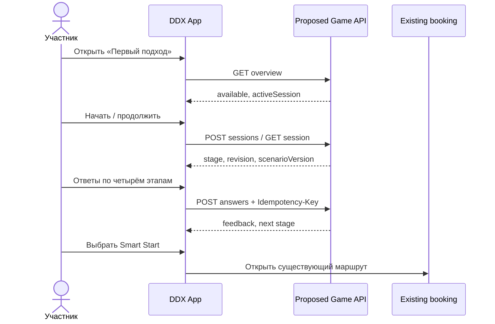

# 01 · System context

## Цель
Встроить необязательную короткую игровую практику правил клуба в DDX Fitness App. Не менять биллинг, тарифные права, посещения, данные InBody и действующие сценарии записи.

| Контур | Ответственность | Граница взаимодействия |
|---|---|---|
| DDX App | Авторизация, клиентский UI, навигация | Открывает игру и существующий экран записи |
| Контур членства DDX | Статус участника | Предоставляет решение о праве запуска; реальные контракты неизвестны |
| Игровой домен (проект) | Сценарий, состояние, ответы и события | Самостоятельные API и хранилище |
| Контент | Правила и версии инструкций | Методическое подтверждение и лицензии на ассеты |
| Система записи DDX | Услуги, расписание, брони и посещения | Игра передаёт управление, но не записывает сама |
| Аналитика | Экспозиция, группы эксперимента, атрибуция | Раздельный учёт кликов, брони, фактического посещения |

## Последовательность

Игровые ошибки возвращают принятый результат с объяснением без продвижения этапа. Потеря ответа допускает безопасный повтор. Контракты DDX неизвестны; имена контуров здесь условные.
