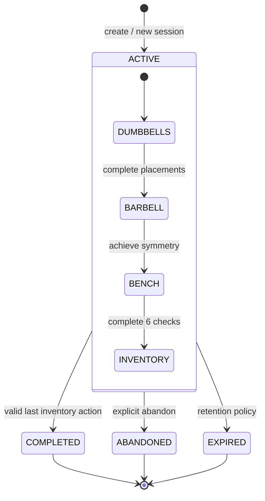

# 03 · Session state machine

Разделяем **жизненный цикл сессии** (`status`) и **позицию внутри сценария** (`stage` + `stageProgress`). `COMPLETED` — терминальный исход, не пятая станция.

## Transition semantics

| Trigger | Guard | Effect |
|---|---|---|
| `start` | Eligible, no ACTIVE session | Create ACTIVE; DUMBBELLS; stageProgress=0; revision=1; pinned scenarioVersion |
| `submitAction`, correct | ACTIVE; correct stage; current revision; action matches current scenario | Persist accepted action; advance progress/stage; revision+1; emit outbox event when stage/session completes |
| `submitAction`, incorrect | Same preconditions; answer is a valid but wrong game action | accepted=false; explanatory feedback; same stage/progress/revision; attempt may be recorded |
| `submitAction`, stale | expectedRevision != persisted revision, new idempotency key | 409 STALE_REVISION; no transition |
| `submitAction`, replay | Same idempotency key and payload | Return persisted previous result before re-evaluating revision; no new attempt/event |
| `submitAction`, reused key with changed payload | Key already bound to different payload | 409 IDEMPOTENCY_KEY_REUSED; no effect |
| `abandon` | ACTIVE + current revision | ABANDONED; revision+1 |
| `expire` | ACTIVE + configured expiry policy | EXPIRED; revision+1; policy defined later |
| `CTA` | Any stage or no game session | Client navigation only; no session change and no booking write |

## Example: lost HTTP response

- Client submits `{stage:DUMBBELLS, expectedRevision:1, action:{kind:DUMBBELL_PLACEMENT, itemId:PAIR_8, targetId:RACK_8}}` with `Idempotency-Key: a`.
- Server commits revision=2 and answer response; network drops response.
- Client retries **exact same body** with key `a`; receives original revision=2 response.
- New key with old revision=1 gives `409 STALE_REVISION`, not duplicated game action.

## Concurrency boundaries

Unique ACTIVE session is enforced in storage, not via GET-before-POST. Compare-and-swap on `revision` applies at **each** accepted action. Transaction groups session update, idempotency record and outbox write. Server is authoritative; client progress is display state only.

[System requirements](02-requirements.md) · [Data model](04-data-model.md)
