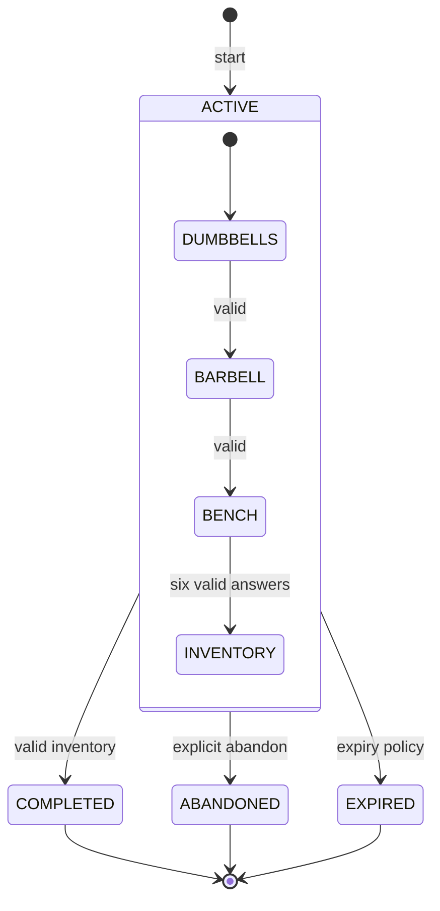

# 03 · State machine

Статусы: ACTIVE, COMPLETED, ABANDONED, EXPIRED. Для ACTIVE этапы DUMBBELLS → BARBELL → BENCH → INVENTORY.

Каждый переход атомарно повышает revision. Неуспешная игровая попытка фиксируется однократно, но этап остаётся прежним. 409 при конфликте версий; безопасный повтор при потерянном ответе с тем же ключом. После терминального статуса можно начать новую независимую сессию.

**Особые случаи:** два устройства одновременно; отключённый флаг входа; новая версия сценария; недоступен Smart Start. В последнем случае сессия остаётся COMPLETED.
