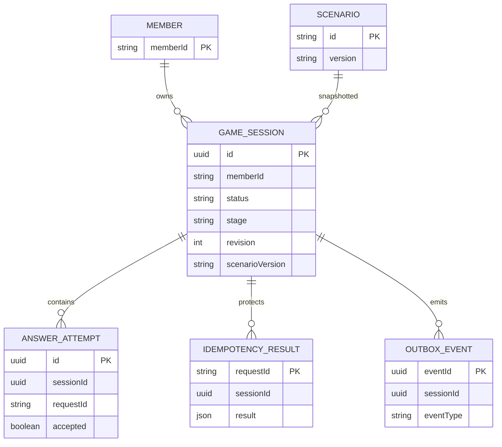

# 04 · Conceptual data model

Уникальность (sessionId,requestId), только одна ACTIVE-сессия на memberId, CHECK допустимых этапов/статусов, атомарная запись перехода и outbox. Никакого дублирования профиля, оплат, медицинских данных или бронирований. Outbox — предлагаемый вариант, не подтверждённый стек DDX.
