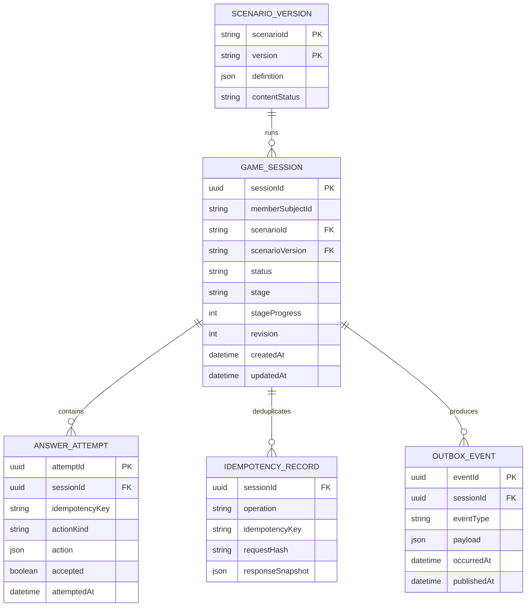

# 04 · Logical data model (proposed)

[Кейс](../../../README.md) / [Карта артефактов](../../../NAVIGATION.md) / [SA · Системный анализ](../README.md) / **04 · Data Model**

Это **логическая модель ответственности игрового домена**, не SQL-схема действующей БД DDX. Внешние данные о членстве, расписании и записи **не копируются** в игровой домен.

## Consistency constraints

| Invariant | Предложенный механизм |
|---|---|
| Сценарий нельзя переписать в активной сессии | FK (`scenarioId`, `scenarioVersion`) → неизменяемая `SCENARIO_VERSION` |
| Один ACTIVE на участника | Частичный уникальный индекс по `memberSubjectId WHERE status='ACTIVE'` |
| Корректный stage/status/progress | CHECK и серверная state machine; после COMPLETED stage = null |
| Повтор безопасен | UNIQUE(`sessionId`, `operation`, `idempotencyKey`), hash payload, сохранённый responseSnapshot |
| Потеря ответа не создаёт новый переход | Одна транзакция: update с revision check + attempt + idem result + outbox |
| Нет чужого доступа | Сопоставление `memberSubjectId` с авторизованным subject на каждом GET/POST |
| Доставка событий отдельно от изменения сессии | Transactional outbox **как один из вариантов**, не как утверждение о технологии DDX |

**Для `start`:** сессии ещё нет, поэтому запись идемпотентности должна иметь scope `(memberSubjectId, 'START', idempotencyKey)` отдельно от scope действий сессии. В конкретной физической схеме можно использовать общий idempotency store с полем `scopeId`; изображённая ERD показывает прежде всего действия уже созданной сессии.

## Data ownership & privacy

- `memberSubjectId` — непрозрачная ссылка на доверенный внешний контекст авторизации; не профиль члена клуба.
- Аналитическая связь с `experimentAssignment` и подтверждённым посещением устанавливается **согласованной** аналитической платформой, а не хранением истории бронирования в игре.
- События игрового домена не содержат ФИО, номера телефона, данных InBody, платежей.
- Retention, TTL идемпотентности, использование технических логов и требования удаления данных определяются по политике DDX; точных чисел нет.

---

**Связь SA ↔ BA:** [Business Rules](../../ba/docs/02-business-requirements.md) · [Product Decisions](../../ba/docs/05-decisions.md)

**Маршрут:** [← State Machine](03-state-machine.md) · [Карта артефактов](../../../NAVIGATION.md) · [Events →](05-events.md)
